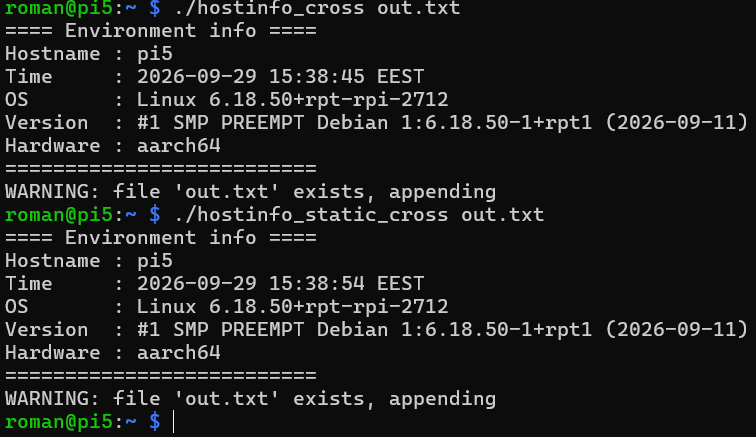

# TASK04 — hostinfo: збірка на HOST і TARGET

## 1. Мета і склад репозиторію
Програма `hostinfo.c` виводить hostname, час, ОС і архітектуру (`uname`, `time`)
та, якщо задано ім'я файлу аргументом, дописує вивід у файл (з попередженням,
якщо файл уже існує).

| Файл | Призначення |
|---|---|
| `hostinfo.c` | програма |
| `build_host.sh` | нативна динамічна збірка + тест + аналіз |
| `build_target.sh` | крос-збірка `aarch64-linux-gnu-gcc` |
| `build_static.sh` | збірка з `-static` |
| `analyze.sh` | аналіз binutils (file, readelf, ldd, size, objdump, strings) |
| `reports/` | сирі результати аналізу (`<бінарник>@<хост>.txt`) |

## 2. Середовище
| | HOST | TARGET |
|---|---|---|
| Машина | ПК, WSL2 (Ubuntu 26.04) | Raspberry Pi 5, 16 ГБ ОЗП |
| Ядро | 6.18.33.2-microsoft-standard-WSL2 | 6.18.50+rpt-rpi-2712 |
| ОС | Ubuntu 26.04 LTS | Debian GNU/Linux 13 (trixie), стоковий образ Raspberry Pi OS |
| Архітектура | x86_64 | aarch64 |
| gcc | 15.2.0 (Ubuntu 15.2.0-16ubuntu1) | 14.2.0 (Debian 14.2.0-19) |
| glibc | 2.43 (Ubuntu 26.04) | 2.41 (Debian 2.41-12+rpt1+deb13u4) |
| Часовий пояс у виводі | UTC | EEST |
| Крос-компілятор | `aarch64-linux-gnu-gcc` 15.2.0 (пакет `gcc-aarch64-linux-gnu`) | — |

У стоковому образі TARGET вже встановлені `gcc`, `git`, `make`, `file`, `readelf`,
`objdump`, `size`, `strings`, `ldd`, тобто середовище розробки на TARGET є ще до
виконання п. 4.

## 3. Крок 2 — нативна збірка на HOST
Команда: `gcc -std=c11 -Wall -Wextra -Werror -O2 hostinfo.c`.

**Перевірка працездатності:**
- вивід у консоль містить hostname, час, ОС, версію ядра, архітектуру — так;
- перший запуск з файлом створює його, другий виводить
  `WARNING: file 'build/t.txt' exists, appending` і дописує другий блок — так.

**Аналіз binutils** (`reports/hostinfo_native@Roman.txt`):
- ELF64 PIE, x86-64, динамічний; interpreter `/lib64/ld-linux-x86-64.so.2`
- залежність лише `libc.so.6`
- розмір 16 456 байт; `size`: text 3080, data 664, bss 48
- потрібні версії glibc: до `GLIBC_2.34`
- у `strings` є `__fprintf_chk` і `__stack_chk_fail`: Ubuntu вмикає
  FORTIFY_SOURCE і stack protector за замовчуванням

## 4. Крок 3 — крос-збірка HOST→TARGET
Команда: `aarch64-linux-gnu-gcc -std=c11 -Wall -Wextra -Werror -O2 hostinfo.c`
(`build_target.sh`). Бінарник перенесено на TARGET через `scp`.

**Аналіз на HOST** (`reports/hostinfo_cross@Roman.txt`):
- ELF64 PIE, AArch64; interpreter `/lib/ld-linux-aarch64.so.1`
- NEEDED: `libc.so.6` і `ld-linux-aarch64.so.1`
- розмір 70 992 байти; `size`: text 3270, data 744, bss 8
- потрібні версії glibc: `GLIBC_2.17` … `GLIBC_2.34`
- запуск на HOST: `Exec format error` (очікувано, чужа архітектура)
- `ldd` на HOST: `not a dynamic executable`, залежності видно лише через `readelf -d`

**Запуск і аналіз на TARGET** (`reports/hostinfo_cross@pi5.txt`):
- бінарник запустився без змін; перший запуск виводить блок у консоль,
  запуск з `out.txt` створює файл, повторний виводить
  `WARNING: file 'out.txt' exists, appending` і дописує другий блок — так
- `ldd` на TARGET працює: `libc.so.6 => /lib/aarch64-linux-gnu/libc.so.6`
- `readelf`, `size`, `strings`, розмір і BuildID збігаються з результатами на HOST
  (BuildID `6b89f56f56e6460c79c863b78e000488d87fa32f`): файл не змінився під час перенесення
- максимальна потрібна версія glibc 2.34 ≤ 2.41 на TARGET, тому сумісність є

Запуск на TARGET (динамічний hostinfo_cross і статичний hostinfo_static_cross,
обидва зібрані на HOST):

## 5. Крок 4 — нативна збірка на TARGET
**Середовище розробки.** У стоковому образі вже були `build-essential 12.12`,
`gcc 14.2.0`, `binutils 2.44`, `git 2.47.3`. Команда
`sudo apt install -y build-essential git` нічого не встановила (`Installing: 0`),
тому розгортання середовища звелось до перевірки. Пакети не оновлювались
(79 доступних оновлень, стоковий стан збережено).

**Перенесення проєкту.** На TARGET створено SSH-ключ (ed25519) і додано в репозиторій
як Deploy key з правом запису (доступ лише до `TASK04`). `git clone` виконано на
TARGET, після чого запущено `./build_host.sh` без змін.

**Модифікація скрипту:** не знадобилась. `build_host.sh` викликає `gcc` без префікса,
на TARGET це нативний `gcc` 14.2.0, тому перевірка на HOST (п. 4д) не потрібна.

**Перевірка працездатності:** вивід у консоль правильний (`Hostname: pi5`,
`Hardware: aarch64`, час у EEST); другий запуск з файлом виводить
`WARNING: file 'build/t.txt' exists, appending` — так.

**Аналіз binutils** (`reports/hostinfo_native@pi5.txt`):
- ELF64 PIE, AArch64, динамічний; interpreter `/lib/ld-linux-aarch64.so.1`
- NEEDED: лише `libc.so.6`
- розмір 70 968 байт; `size`: text 3076, data 704, bss 8
- потрібні версії glibc: `GLIBC_2.17` … `GLIBC_2.34`
- компілятор у `.comment`: `GCC: (Debian 14.2.0-19) 14.2.0`
- виклики `fprintf`, `fwrite` (у HOST-збірках були `__fprintf_chk`)

**Порівняння native TARGET і cross HOST→TARGET:**

| | cross (Ubuntu gcc 15.2.0) | native (Debian gcc 14.2.0) |
|---|---|---|
| BuildID | `6b89f56f…` | `c5d6fcc8…` |
| розмір | 70 992 | 70 968 |
| text / data / bss | 3270 / 744 / 8 | 3076 / 704 / 8 |
| NEEDED | libc.so.6, ld-linux-aarch64.so.1 | libc.so.6 |
| макс. GLIBC | 2.34 | 2.34 |
| формат виклику | `__fprintf_chk` | `fprintf`, `fwrite` |

Файли відрізняються (різні BuildID), хоча вихідний код і прапорці однакові.

## 6. Крок 5 — статична лінковка (`-static`)
Скрипт `build_static.sh` збирає з `gcc -std=c11 -Wall -Wextra -Werror -O2 -static`.
Статична libc (`libc.a`) уже є на TARGET у складі `build-essential` (`libc6-dev`),
додаткових пакетів не потрібно.

**5а. Збірка на TARGET** (`reports/hostinfo_static@pi5.txt`):
- запуск успішний, вивід коректний
- ELF64, тип `EXEC` (не PIE), AArch64, `statically linked`
- interpreter немає, NEEDED порожній, `ldd`: `not a dynamic executable`
- розмір 849 232 байти; `size`: text 660 632, data 24 340, bss 22 112
- `strings`: 4 456 рядків (у динамічній збірці 105)

**5б. Порівняння dynamic і static на TARGET** (обидві зібрані нативно):

| | dynamic (п. 4) | static (п. 5) | різниця |
|---|---|---|---|
| розмір на диску, байт | 70 968 | 849 232 | ×12 |
| `text`, байт | 3 076 | 660 632 | ×215 |
| тип ELF | DYN (PIE) | EXEC | |
| interpreter | `/lib/ld-linux-aarch64.so.1` | немає | |
| NEEDED | `libc.so.6` | немає | |
| `ldd` | `libc.so.6 => /lib/aarch64-linux-gnu/libc.so.6` | `not a dynamic executable` | |
| макс. GLIBC | 2.34 (залежність від libc TARGET) | версії не вказано, libc 2.41 вбудована | |
| рядків у `strings` | 105 | 4 456 | ×42 |

**5в. Збірки на HOST після `git pull`:**
- native static на HOST: 1 039 424 байти, text 906 040, `statically linked`, запуск на HOST успішний
- cross static HOST→TARGET (`aarch64-linux-gnu-gcc -static`): 849 536 байт, text 676 557,
  BuildID `2b6413a7…`; перенесений на TARGET, запуск успішний, повторний запуск
  виводить `WARNING: file 'out_static.txt' exists, appending`
  (`reports/hostinfo_static_cross@pi5.txt`, `reports/hostinfo_static_cross@Roman.txt`)

**Порівняння native static (TARGET) і cross static (HOST→TARGET):**

| | native static на TARGET | cross static з HOST |
|---|---|---|
| компілятор | Debian gcc 14.2.0 | Ubuntu gcc 15.2.0 |
| BuildID | `5eeae1b5…` | `2b6413a7…` |
| розмір, байт | 849 232 | 849 536 |
| text / data / bss | 660 632 / 24 340 / 22 112 | 676 557 / 23 372 / 22 096 |
| `strings` | 4 456 | 4 575 |

Обидва статичні бінарники повністю самодостатні й працюють на TARGET, але
відрізняються: cross-версія містить libc з sysroot крос-toolchain HOST (пакет Ubuntu
26.04, glibc 2.43 ймовірно), native-версія містить libc TARGET (2.41).

## 7. Порівняльна таблиця
| Збірка | Де зібрано | Де запущено | Розмір, байт | Макс. GLIBC | NEEDED | Результат |
|---|---|---|---|---|---|---|
| native dynamic | HOST (x86_64) | HOST | 16 456 | 2.34 | libc.so.6 | працює |
| cross dynamic | HOST (x86_64→aarch64) | HOST | 70 992 | 2.34 | libc.so.6, ld-linux-aarch64.so.1 | `Exec format error` |
| cross dynamic | HOST (x86_64→aarch64) | TARGET | 70 992 | 2.34 | libc.so.6, ld-linux-aarch64.so.1 | працює |
| native dynamic | TARGET | TARGET | 70 968 | 2.34 | libc.so.6 | працює |
| native static | TARGET | TARGET | 849 232 | вбудована 2.41 | немає | працює |
| native static | HOST | HOST | 1 039 424 | вбудована | немає | працює |
| cross static | HOST (x86_64→aarch64) | TARGET | 849 536 | вбудована | немає | працює |

## 8. Спостереження
- Код в aarch64 і x86 майже однаковий (`text` 3270 і 3080 байт), проте файл
  aarch64 більший більш ніж у чотири рази (70 992 проти 16 456 байт). Причина в
  вирівнюванні сегментів `LOAD`: в aarch64-збірці `Align 0x10000` (64 КБ), в x86
  `0x1000` (4 КБ), тому файл доповнюється до меж 64 КБ-сторінок.
- Програма використовує лише базові виклики (`uname`, `time`, `strftime`,
  `fopen`), тому мінімум `GLIBC_2.34` (це `__libc_start_main`). Збірка з HOST
  (glibc 2.43) запускається на TARGET (glibc 2.41). Якби програма викликала
  функції, додані в glibc 2.42–2.43, динамічна крос-збірка не запустилась би
  (`GLIBC_2.xx not found`), і довелось би збирати зі старішим toolchain, через
  sysroot з образу TARGET або статично.
- `ldd` показує залежності лише для бінарників власної архітектури. На HOST для
  aarch64-файлу він каже `not a dynamic executable`, тому для крос-бінарників
  користуюсь `aarch64-linux-gnu-readelf -d`. Для статичних файлів `ldd` і
  `objdump -T` не дають нічого корисного, там лишаються `file`, `readelf -h/-l`,
  `size`, `strings`.
- Розбіжності середовищ у виводі програми: часовий пояс (UTC на HOST, EEST на
  TARGET), hostname, `machine` (`x86_64` і `aarch64`).
- Права виконання не переносяться між системами автоматично: після `scp` на
  TARGET потрібен `chmod +x`.
- Для цієї програми крос-компіляція не є необхідністю: Raspberry Pi 5 з 16 ГБ
  ОЗП і стоковим gcc збирає її за долі секунди. Крос-збірка виправдана для
  великих проєктів, CI і плат без власного toolchain.
- Один і той самий код з однаковими прапорцями дає різні бінарники залежно від
  toolchain. Ubuntu gcc 15.2.0 (HOST) підставляє `__fprintf_chk` (дефолтне
  `_FORTIFY_SOURCE` Ubuntu), Debian gcc 14.2.0 (TARGET) викликає `fprintf` і
  `fwrite`. Крім того, збірка Ubuntu додає `ld-linux-aarch64.so.1` до NEEDED, а
  Debian ні. Тобто «та сама» програма на різних дистрибутивах фактично збирається
  з різними захисними опціями за замовчуванням.
- Розмір на диску динамічних збірок майже однаковий (70 992 і 70 968 байт), бо він
  визначається 64 КБ-вирівнюванням сегментів aarch64, а не кодом; різниця в `text`
  (3270 проти 3076 байт) відображає різницю компіляторів.
- Статична лінковка в 12 разів збільшує файл (849 232 проти 70 968 байт), а
  `text` майже у 215 разів, бо вся потрібна частина libc вкомпільована у
  виконуваний файл. Натомість файл не залежить від libc на цільовій системі й
  запускається без перевірки версій.
- Версія libc при статичній збірці зафіксована в самому файлі: cross static (з libc
  toolchain HOST) і native static (з libc TARGET) мають різний вміст і різні
  BuildID. Оновлення libc на TARGET не торкнеться такого файлу, тому виправлення в
  libc потребують перезбірки програми.
- Проблем із перенесенням проєкту через git не було. Єдина додаткова дія:
  авторизація TARGET у GitHub через окремий Deploy key.

## 9. Висновки (проблеми крос-розробки)
1. **Архітектура.** Бінарник, зібраний для aarch64, на x86 HOST не запускається
   (`Exec format error`), тому працездатність можна перевірити лише на TARGET (або
   в емуляторі). Тип і цільову архітектуру перевіряю до перенесення командами
   `file` і `readelf -h`.
2. **Аналіз чужих бінарників.** `ldd` працює лише для власної архітектури, тому
   для крос-збірок використовую `${CROSS}readelf -d`, `${CROSS}objdump -T`,
   `${CROSS}size`, `${CROSS}strings`; скрипт `analyze.sh` параметризований змінною
   `CROSS`.
3. **Версії glibc.** Головний ризик динамічної крос-збірки: HOST (glibc 2.43) новіший
   за TARGET (2.41), і якщо програма використає символи, яких у libc TARGET ще
   немає, вона не запуститься. У цьому завданні це не виникло (потрібно лише
   `GLIBC_2.34`), але перевірка проста: порівняти `objdump -T | grep GLIBC` із
   `ldd --version` на TARGET. Способи обійти: sysroot з образу TARGET, старіший
   toolchain, статична лінковка.
4. **Різні toolchain дають різні бінарники.** Ubuntu gcc 15.2.0 і Debian gcc 14.2.0
   збирають один код по-різному (fortify, NEEDED, BuildID, розмір `text`). Для
   відтворюваності збірки треба фіксувати версію компілятора і прапорці.
5. **Перенесення і запуск.** Права `+x` не зберігаються після `scp`, вивід
   залежить від середовища (часовий пояс, hostname). Для роботи з git на TARGET
   потрібна окрема авторизація (Deploy key), а не ключ HOST.
6. **Статика проти динаміки.** Статичний файл більший у 12 разів, але не залежить від
   libc цілі та запускається без перевірки версій; ціна: вшита версія libc без
   оновлень і більший розмір, що критично лише для малої flash-пам'яті.
7. **Практична рекомендація.** Для цієї програми та Raspberry Pi 5 (16 ГБ ОЗП, стоковий
   gcc) найпростіше збирати нативно на TARGET; крос-збірка виправдана для великих
   проєктів, CI і пристроїв без власного toolchain, а перевіряти її треба на цільовому
   залізі, бо успішна компіляція на HOST нічого не гарантує щодо запуску на TARGET.
